# Branding: Logo- und Farbvorschläge

Status: **Entwurf abgeschlossen.** Logo, Farben, Tray-Symbole, Wortmarke, Programm-Symbol und Social-Preview liegen vor.

## Stand

- **Logo:** [09 · Eiswürfel mit warmer Seite](logos/09-eiswuerfel-warm.svg)
  (Variante A2 der fünften Runde, siehe unten). Das K-Logo 08b ist abgelöst.
- **Farben:** kalter Würfel `#1593AF`, warme Seite `#E8780C` hell und `#FF8A1F`
  dunkel, Pause-Balken `#0E1620`. Die Farbschemata (Gletscher) unten gelten
  weiter für Oberflächen und Text.
- **Tray-Zustände:** der Würfel selbst, ohne Kachel, pixelgenau als `.ico` in
  `tray/ico/`: kalt mit Pause-Balken = neutral, rechte Seite warm = Profil
  aktiv, roter Würfel mit Ausrufezeichen = Fehler.
- **Programm-Symbol:** der Würfel hell auf der dunklen Kachel `#12324B`.
- Die Abschnitte ab »Akzent im Dunkelmodus« und alles darunter beschreiben den
  Weg bis 08b und gehören zur Geschichte; `aktueller-stand.html` zeigt noch
  das K-Logo.


### Wortmarke


Der Name in eigenen Buchstaben aus Linien und Kreisbögen mit einer Strichstärke,
ohne Schrift und damit ohne Lizenzfrage. Zwei Fassungen, jeweils für hellen und
dunklen Hintergrund:

- `wortmarke/logo-wortmarke-hell.svg`, `-dunkel.svg`: Logo und Name.
- `wortmarke/wortmarke-hell.svg`, `-dunkel.svg`: nur der Name; das erste k
  trägt dann den warmen, abgesetzten Arm.

Für eine GitHub-README, die dem Design des Lesers folgt:

```html
<picture>
  <source media="(prefers-color-scheme: dark)" srcset="branding/wortmarke/logo-wortmarke-dunkel.svg">
  
</picture>
```

### Programm-Symbol

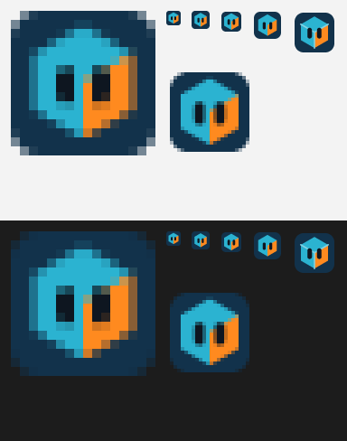

`app/kaltstellen.ico` mit 16, 20, 24, 32, 40, 48, 64 und 256 px, für die `.exe`,
Verknüpfungen und das Fenster: das Logo hell auf dunkler Kachel `#12324B`, der
warme Arm in `#FF8A1F`. Unter 40 px bleibt der Arm am Stamm, weil die Lücke
sonst nur einen Punkt übrig ließe. Auf dunklem Grund hebt sich die Kachel kaum
ab, das K bleibt stehen.

### Social-Preview für GitHub

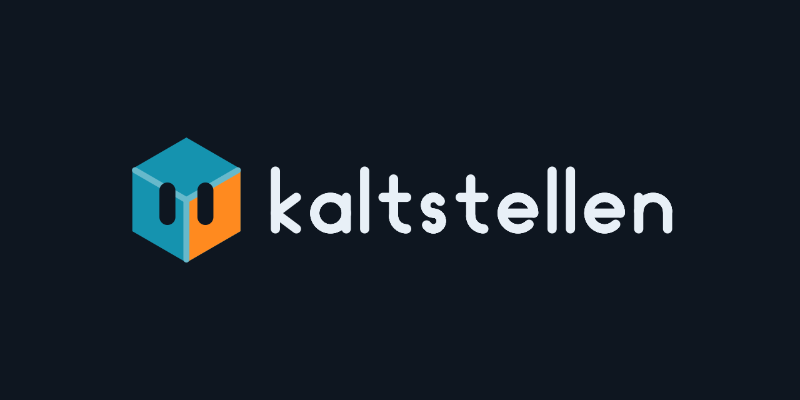

`social/social-preview.png`, 1280 × 640 px, zum Hochladen unter Settings →
Social preview. Quelle ist `social/social-preview.svg`; beide schreibt
`make_marke.py`, ebenso die Wortmarken: `python branding/make_marke.py`.

### Tray-Symbole, reingezeichnet

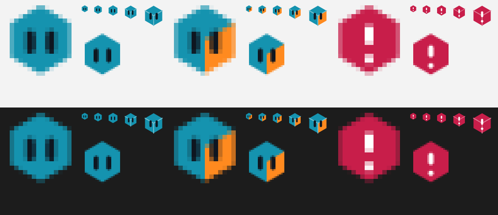

Gezeichnet mit dem Würfel (Stand fünfte Runde). Die Tabelle unten beschreibt noch die K-Kacheln der vierten Runde.

Je Zustand: 16 px zehnfach vergrößert, darunter 24 px vierfach, daneben 16, 20,
24, 32 und 48 px in Originalgröße. Oben helle, unten dunkle Taskleiste.

| Zustand | Datei | Kachel | Zeichen | Kachel zur Taskleiste |
| --- | --- | --- | --- | --- |
| neutral | `tray/ico/kaltstellen-neutral.ico` | `#2A8FD6` | weißes K | 3,2 hell, 4,9 dunkel |
| Profil aktiv | `tray/ico/kaltstellen-aktiv.ico` | `#FF8A1F` | dunkles K `#0E1620` | 2,1 hell, 7,2 dunkel |
| Fehler | `tray/ico/kaltstellen-fehler.ico` | `#C81E4A` | weißes Ausrufezeichen | 5,1 hell, 3,0 dunkel |

- »Profil aktiv« und »Fehler« lagen als Orange und Rot zu nah beieinander
  (1,2 bis 1,8 : 1 zwischen den Kacheln). Jetzt unterscheiden sie sich im
  Farbton (Orange gegen Karminrot), in der Helligkeit (2,4 : 1) und im Zeichen
  (dunkles K gegen weißes Ausrufezeichen).
- Weil das K auf Orange dunkel ist, reicht eine Fassung für helle und dunkle
  Taskleiste. Auf der hellen hebt sich die orange Kachel selbst nur mit 2,1 : 1
  ab, das dunkle K darin aber mit 7,7 : 1.
- Jede `.ico` enthält 16, 20, 24, 32, 48 und 256 px. Jede Größe ist aus eigener
  Pixelgeometrie gezeichnet, nicht aus einem großen Bild verkleinert; die
  Einzelbilder liegen als PNG in `tray/png/`.
- Erzeugt werden sie von `tray/make_icons.py` (nur Python-Standardbibliothek):
  `python branding/tray/make_icons.py`. Farben und Maße je Größe stehen oben im
  Skript.
- Unter 32 px entfällt die Lücke am Arm, weil dort nur ein Punkt übrig bliebe;
  die Kachelfarbe trägt den Zustand.
- Links vom Stamm stehen zwei kurze, dünne, blassere Strahlen: die angedeutete
  zweite Kristallhälfte aus dem Logo. Bei 16 px sind sie gut einen Pixel breit.
- Die Einträge sind PNG-komprimiert. Das lesen Windows Vista und neuer. Geprüft:
  Windows lädt aus allen `.ico`-Dateien die 16-, 32- und 256-px-Fassung.

### Tray-Zustände: die beiden Ansätze

Im Tray fällt die blasse Kristallhälfte weg und die Striche werden dicker; das
volle Logo bleibt für README, Avatar und Fenster. Jeder Zustand ist in 32, 24
und 16 px gezeichnet, links auf heller, rechts auf dunkler Taskleiste. Das sind
die Skizzen, aus denen die Reinzeichnung oben entstanden ist.

**Ansatz 1: das K trägt den Zustand** (`tray/k-*.svg`), nicht gewählt

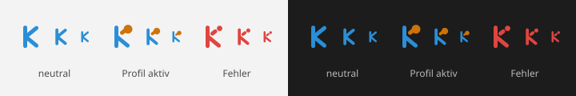

Neutral ist das ganze K blau. Ist ein Profil aktiv, legt sich der Arm um und
bekommt einen großen orangen Knopf; bei einem Fehler wird das ganze K rot und
der Arm zum Ausrufezeichen. Bleibt nah am Logo; der Unterschied zwischen
neutral und aktiv ist bei 16 px ein oranger Punkt von etwa 5 Pixeln.

**Ansatz 2: eine Kachel trägt den Zustand** (`tray/kachel-*.svg`), gewählt

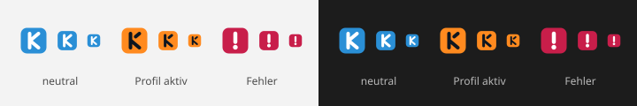

Das K steht weiß auf einer Kachel, und die ganze Kachel wechselt die Farbe:
blau = neutral, orange = Profil aktiv, rot mit Ausrufezeichen = Fehler. Bei
16 px am deutlichsten, weil die ganze Fläche den Zustand zeigt; dafür sieht das
Tray-Symbol dem zweifarbigen Logo weniger ähnlich.

Gewählt ist **Ansatz 2.** Nur eine ganze Farbfläche ist bei 16 px nicht zu
übersehen. Blau und Orange lassen sich auch bei Rot-Grün-Schwäche
unterscheiden, und der Fehler hat zusätzlich eine eigene Form. Ansatz 1 ist die
Wahl, wenn das Tray-Symbol wie das Logo aussehen soll.

### Akzent im Dunkelmodus

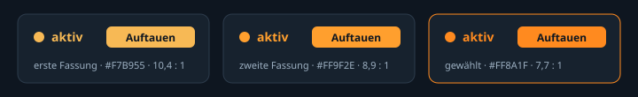

Die erste Fassung `#F7B955` war ein helles, ausgewaschenes Gelborange, die
zweite `#FF9F2E` schon kräftiger. Gewählt ist die kräftigste, `#FF8A1F`
(7,7 : 1 auf dem dunklen Hintergrund).

Im Hellmodus ist der Akzent jetzt `#B54300` statt `#A85A00`: rötlicher und
satter, mit 5,2 : 1 statt 4,8 : 1. Viel mehr geht bei Orange auf Weiß nicht,
ohne dass es braun oder rot wird.

Alles ab hier ist der Weg dorthin: die Vorschläge der einzelnen Runden.

Fünf Logo-Richtungen, drei Kombinationen daraus, je eine weitere Runde zu
den Kombinationen 07 und 08 und drei Farbschemata für `kaltstellen`. Alle Marken sind
eigene, von Hand geschriebene SVG-Skizzen auf einem 32er-Raster, ohne fremde
Icon-Sets, Schriften oder Markenzeichen. Sie stehen unter derselben Lizenz wie
der Rest des Repos.

Zum schnellen Vergleichen: [uebersicht.html](uebersicht.html) im Browser öffnen.
Dort sind die kleinen Größen in echten 32 und 16 Pixeln gezeichnet. Die Bilder
unten zeigen dasselbe, werden aber je nach Fensterbreite skaliert.

## Logo-Richtungen

Jede Vorschau zeigt die Marke groß und als Tray-Symbol in 32 und 16 px, links
auf hellem, rechts auf dunklem Grund. Die Marken verwenden ein mittleres Blau
(`#2A8FD6`), das auf heller wie dunkler Taskleiste über 3 : 1 Kontrast hält,
sodass eine einzige Datei für beide Windows-Designs reicht.

### 01 · Eiswürfel


Ein Eiswürfel mit Pause-Zeichen: »auf Eis legen« und »anhalten« in einem Bild.
Die geschlossene Fläche bleibt auch bei 16 px ein klarer Fleck, die beiden
Balken sind dort je 2 px breit.

### 02 · Kristall-K

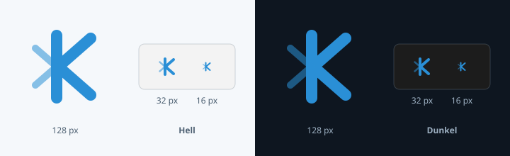

Das K von kaltstellen als Eiskristall: Stamm und zwei kräftige Arme, die andere
Kristallhälfte ist nur blass angedeutet. Als Buchstabenmarke eigenständig und
gut für Avatar und Wortmarke; bei 16 px liest man je nach Blick ein K oder eine
Schneeflocke, beides passt.

### 03 · Schalter


Ein Kippschalter: links die eingefrorene Seite mit Pause-Zeichen, rechts der
warme Knopf für das aktive Profil. Erzählt das Umschalten am direktesten, ist
aber breit statt quadratisch und nutzt die Tray-Fläche nur zur Hälfte.

### 04 · Profilring

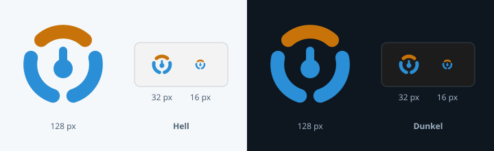

Ein Drehschalter: drei Ringsegmente stehen für drei Profile, der Zeiger steht
auf dem aktiven, warmen Segment. Das aktive Segment könnte im Tray mitwandern;
das Motiv sagt aber nichts über Kälte oder Einfrieren und erinnert entfernt an
ein Power-Symbol.

### 05 · Eisberg


Nur die Spitze ist oben und arbeitet, der große Rest liegt still unter der
Wasserlinie. Das ruhigste und bildhafteste Motiv, es erklärt aber weder Pause
noch Umschalten und lebt von der zweiten Tonstufe.

## Zweite Runde: Kombinationen

Rückmeldung zur ersten Runde: An 02 gefällt das K, an 03 die Schalter-Idee, an
04 die warme Kontrastfarbe. Daraus drei Mischungen.

### 06 · K-Hebel

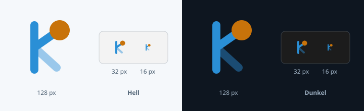

Das K ist selbst der Schalter: Der obere Arm ist der Hebel mit warmem Knopf in
der aktiven Stellung, der untere Arm die blasse, kalte Stellung. Verbindet
Buchstabe, Umschalten und Kontrastfarbe in einem Zeichen; bei 16 px bleiben
Stamm, Hebel und der warme Punkt übrig.

### 07 · Schalter mit K

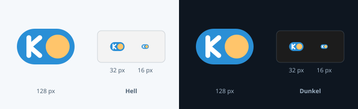

Der Kippschalter aus 03, aber auf der kalten Seite steht statt der Pause das K,
rechts der warme Knopf. Liest sich sofort als Schalter, aber K und Knopf ergeben
zusammen »KO«, und bei 16 px ist das K nur noch drei Pixel breit.

### 08 · K zweifarbig

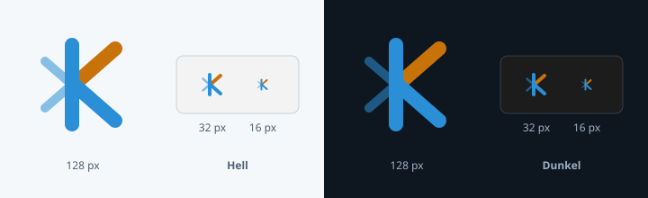

Das Kristall-K aus 02, bei dem ein Arm warm leuchtet: ein Arm aktiv, der Rest
kalt. Die kleinste Änderung gegenüber 02 und im Tray am kräftigsten, erzählt das
Umschalten aber nur über die Farbe.

## Dritte Runde: 07 als Schalter geschärft

Rückmeldung zur zweiten Runde: 07 passt am besten, aber die Farben stimmen noch
nicht ganz und der Schalter-Charakter ist verloren gegangen. Zwei Ursachen in
der Skizze: Der Knopf war ein blasses Gelb statt des kräftigen Bernsteins aus
04, und K und Knopf waren gleich groß, sodass man zwei Zeichen (»KO«) statt
Bahn und Knopf las. Alle vier Varianten nehmen das kräftigere Orange `#D6770B`.

### 07a · Zweifarbige Bahn

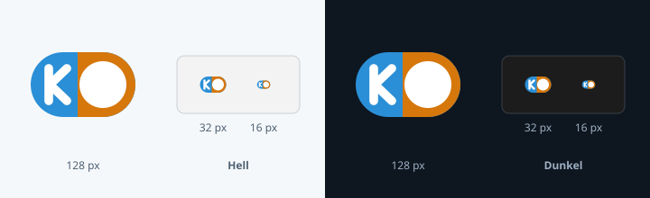

Die Bahn ist links kalt und rechts warm, der Knopf ist weiß und sitzt auf der
warmen Seite. Der weiße Knopf ist das vertraute Schalterbild und die Farben sind
kräftiger; der Knopf im warmen Ring lässt sich aber weiter als O lesen, also
»KO«.

### 07b · Großer Knopf

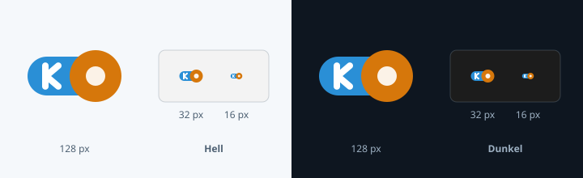

Schmale Bahn, der warme Knopf ist größer als die Bahn und steht über sie hinaus.
Als Form am deutlichsten ein Schalter, dafür wird das K klein und verschwindet
bei 16 px.

### 07c · Umriss

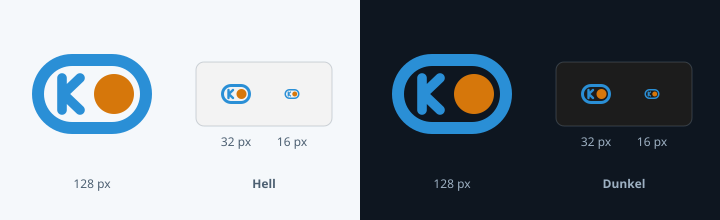

Die Bahn ist nur eine Linie, das K blau, der Knopf warm und voll gefüllt.
Leichter und heller als die anderen, bei 16 px aber dünn, und die Lesart »KO«
bleibt.

### 07d · K auf dem Knopf

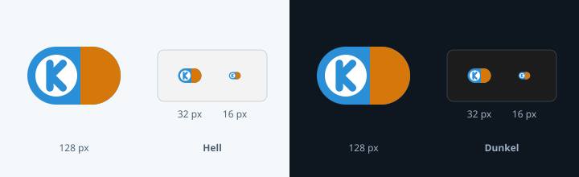

Das K sitzt auf dem weißen Knopf, und der Schalter steht auf der kalten Seite:
auf »K« gestellt, kaltgestellt. Die warme Hälfte bleibt als Gegenpol frei. Kein
zweiter Kreis mehr, also kein »KO«, und das K ist blau auf Weiß am besten
lesbar; die zweifarbige Form kann an eine Kapsel erinnern.

### 07d in anderen Farben

| Farbstellung | Vorschau | Anmerkung |
| --- | --- | --- |
| Tiefblau `#1F6FB5` und Orange `#F08A24` | 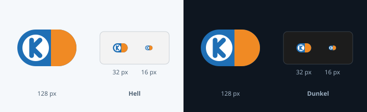 | Mehr Spannung zwischen kalt und warm; das Orange liegt auf heller Taskleiste unter 3 : 1, grenzt dort aber an Blau und Weiß. |
| Indigo `#6F7DF5` und Mint `#0F9485` | 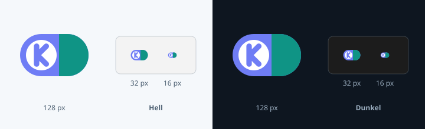 | Farben von Schema B. Kühler und technischer, der Gegensatz kalt/warm geht verloren. |
| Petrol `#0E9AA7` und Sonnengelb `#D9A300` | 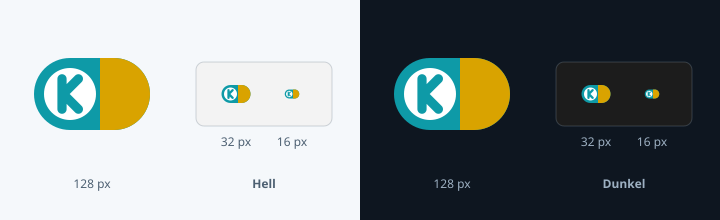 | Farben von Schema C mit hellerem Gelb. Freundlich, das Gelb ist auf heller Taskleiste schwach. |

## Vierte Runde: 08 näher angesehen

Drei Formvarianten des zweifarbigen K, eine zweite Farbstellung und die
Tray-Zustände. Alle nehmen das kräftigere Orange `#D6770B`.

### 08a · K klar

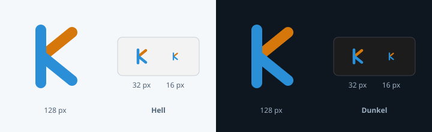

Nur noch Stamm, kalter Arm und warmer Arm, ohne die blasse Kristallhälfte, mit
etwas dickeren Strichen und dem kräftigeren Orange. Bei 16 px die sauberste
Fassung und sofort ein K; der Bezug zum Eiskristall geht dabei verloren.

### 08b · K abgesetzt

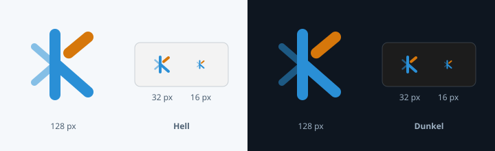

Die Kristallhälfte bleibt, der warme Arm ist durch eine Lücke vom Stamm
getrennt: ein eigenes, bewegliches Teil, das umgelegt werden kann. Holt etwas
Schalter-Idee in das K; bei 16 px ist die Lücke ein einzelnes Pixel und der Arm
wirkt eher abgebrochen.

### 08c · K auf Kachel

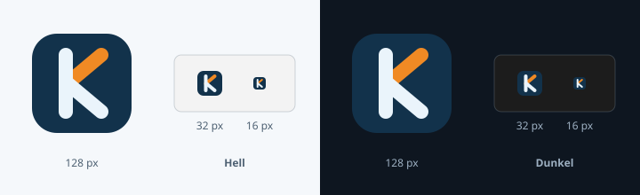

Das klare K hell auf einer dunklen Kachel (`#12324B`), der warme Arm leuchtet.
Als Avatar und App-Symbol am ruhigsten; auf dunkler Taskleiste verschwindet die
Kachel fast, das K bleibt stehen.

### 08a in Tiefblau und Orange

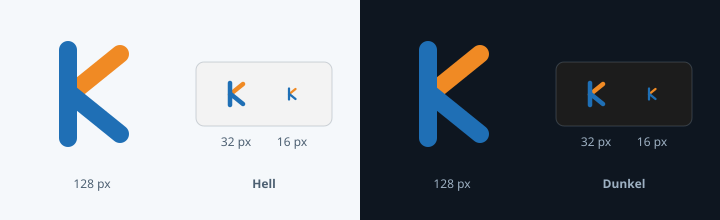

Dieselbe Form mit dunklerem Blau `#1F6FB5` und leuchtenderem Orange `#F08A24`.
Auf dunklem Grund sehr lebendig; auf heller Taskleiste liegt das Orange unter
3 : 1 und der warme Arm wird der schwächere.

### 08 · Tray-Zustände

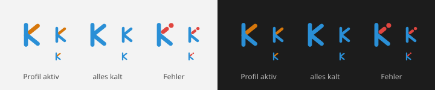

Der warme Arm trägt den Zustand: orange = ein Profil ist aktiv, beide Arme
blau = alles kaltgestellt, roter, gebrochener Arm mit Punkt = Fehler. Der Fehler
unterscheidet sich auch in der Form (er liest sich als schräges
Ausrufezeichen); »aktiv« und »alles kalt« unterscheiden sich nur in der Farbe
eines Arms.

## Fünfte Runde: weg vom K

Rückmeldung zu 08b: sieht zu sehr nach KDE aus. Gründe: ein einzelnes großes K
(bei KDE das Markenzeichen), das Blau `#2A8FD6` nah am Plasma-Blau von Breeze,
dicke abgerundete Striche und eine abgerundete Kachel im Tray.

Fünf Entwürfe ohne K, ohne Kachel und ohne Breeze-Blau: Eiswürfel mit Pause,
Eisberg, Frostflocke, Thermometer, Kristallraute. Gewählt wurde der Eiswürfel.
Weil ihm eine Kontrastfarbe fehlte, entstanden drei Varianten, gewählt ist
**A2**: die rechte Würfelseite ist warm, die Pause-Balken bleiben dunkel. Der
Gegensatz kalt/warm trägt die Zustände: im Tray kippt nur die rechte Seite von
kalt auf warm.

Anmerkung: Die zwei dunklen Balken können bei sehr kleinen Größen wie Augen
wirken; das Zeichen bleibt dadurch aber auch bei 16 px eindeutig.

## Farbschemata

Jedes Blatt zeigt links die helle, rechts die dunkle Variante: eine
Beispielkarte, die sieben Rollenfarben und unten die drei Tray-Zustände auf
heller (`#F3F3F3`) und dunkler (`#1C1C1C`) Taskleiste.

Die Zustände unterscheiden sich immer in Farbe **und** Zeichen (Play, Pause,
Ausrufezeichen), damit sie auch bei Farbfehlsichtigkeit lesbar bleiben. Die
Zustandssymbole sind hier mit dem Eiswürfel gezeichnet; für eine andere Marke
müsste das Zeichen als kleines Abzeichen an die Marke wandern.

Kontrastwerte nach WCAG 2.x, jeweils gegen den Hintergrund des Modus. Richtwerte:
4,5 : 1 für Text, 3 : 1 für Grafiken und Bedienelemente.

### A · Gletscher


Eisblau mit warmem Bernstein als Gegenpol: kalt = geparkt, warm = läuft.

| Rolle | Hell | Dunkel |
| --- | --- | --- |
| Hintergrund | `#F5F8FB` | `#0E1620` |
| Fläche | `#FFFFFF` | `#17222E` |
| Linie | `#D3DDE7` | `#2C3B4B` |
| Text | `#10202E` (15,5) | `#E8F0F7` (15,8) |
| Text gedämpft | `#4D6072` (6,1) | `#9DB0C2` (8,2) |
| Primär | `#0B69A8` (5,5) | `#5BB8F0` (8,3) |
| Akzent | `#B54300` (5,2) | `#FF8A1F` (7,7) |
| Schrift auf Primär | `#FFFFFF` (5,8) | `#0E1620` (8,3) |

| Tray-Zustand | Farbe | helle Taskleiste | dunkle Taskleiste |
| --- | --- | --- | --- |
| neutral | `#2A8FD6` | 3,2 | 4,9 |
| Profil aktiv | `#FF8A1F`, dunkles K | 2,1 | 7,2 |
| Fehler | `#C81E4A` | 5,1 | 3,0 |

Schwachpunkt: Bernstein für »aktiv« und Rot für »Fehler« liegen im Farbkreis
nah beieinander und Bernstein wird sonst oft als Warnung gelesen. Das Zeichen
im Symbol muss die Unterscheidung mittragen.

### B · Polarlicht

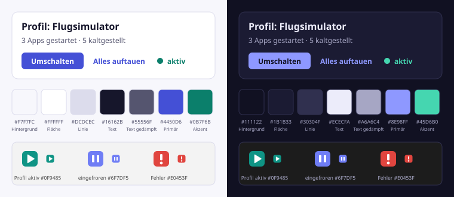

Indigo der Polarnacht mit Mintgrün des Polarlichts: technischer, weniger
»Wetter-App«.

| Rolle | Hell | Dunkel |
| --- | --- | --- |
| Hintergrund | `#F7F7FC` | `#111122` |
| Fläche | `#FFFFFF` | `#1B1B33` |
| Linie | `#DCDCEC` | `#30304F` |
| Text | `#16162B` (16,6) | `#ECECFA` (15,9) |
| Text gedämpft | `#55556F` (6,7) | `#A6A6C4` (7,9) |
| Primär | `#4450D6` (5,8) | `#8E98FF` (7,2) |
| Akzent | `#0B7F6B` (4,6) | `#45D6B0` (10,2) |
| Schrift auf Primär | `#FFFFFF` (6,2) | `#111122` (7,2) |

| Tray-Zustand | Farbe | helle Taskleiste | dunkle Taskleiste |
| --- | --- | --- | --- |
| Profil aktiv | `#0F9485` | 3,4 | 4,5 |
| neutral | `#6F7DF5` | 3,2 | 4,8 |
| Fehler | `#E0453F` | 3,7 | 4,1 |

Stärke: Grün für »aktiv«, Rot für »Fehler« ist die gewohnte Ampel-Lesart.
Schwachpunkt: Grün und Rot sind genau das Paar, das bei Rot-Grün-Schwäche
verschwimmt; und Indigo wirkt weniger nach Eis als Blau oder Petrol.

### C · Wintersonne

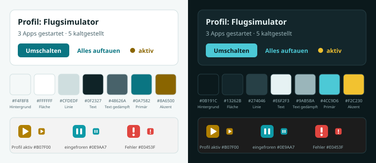

Petrol wie Gletscherwasser mit Sonnengelb: freundlich und am weitesten weg vom
üblichen Windows-Blau.

| Rolle | Hell | Dunkel |
| --- | --- | --- |
| Hintergrund | `#F4F8F8` | `#0B191C` |
| Fläche | `#FFFFFF` | `#13262B` |
| Linie | `#CFDEDF` | `#274046` |
| Text | `#0F2327` (15,2) | `#E6F2F3` (15,7) |
| Text gedämpft | `#48626A` (6,1) | `#9AB5BA` (8,3) |
| Primär | `#0A7582` (5,1) | `#4CC9D6` (9,1) |
| Akzent | `#8A6500` (5,0) | `#F2C230` (10,7) |
| Schrift auf Primär | `#FFFFFF` (5,4) | `#0B191C` (9,1) |

| Tray-Zustand | Farbe | helle Taskleiste | dunkle Taskleiste |
| --- | --- | --- | --- |
| Profil aktiv | `#B07F00` | 3,2 | 4,8 |
| neutral | `#0E9AA7` | 3,1 | 5,0 |
| Fehler | `#E0453F` | 3,7 | 4,1 |

Schwachpunkt: Gelb muss für helle Hintergründe stark abgedunkelt werden und
kippt dabei ins Ocker; das leuchtende Sonnengelb gibt es nur im dunklen Modus.

## Empfehlungen der einzelnen Runden

Gewählt wurde am Ende 08b mit Schema A, siehe [Stand](#stand). Zur
Nachvollziehbarkeit die Empfehlungen, die es unterwegs gab.

Nach der vierten Runde: **08a · K klar für Tray und Wortmarke, 08c · K auf
Kachel als Avatar, in Schema A · Gletscher.**

- 08a ist von allen Vorschlägen bei 16 px am besten lesbar: ein K, ein warmer
  Arm, sonst nichts.
- Der Arm kann im Tray den Zustand tragen, und dieselbe Form funktioniert auf
  der Kachel als GitHub-Avatar.
- Gegen 07d abgewogen: 07d erzählt das Umschalten in der Form und ist groß das
  originellere Zeichen, verliert im Tray aber das K. 08a behält das K in jeder
  Größe und erzählt das Umschalten nur über die Farbe.

Stand nach der dritten Runde war: **07d · K auf dem Knopf, in Schema A · Gletscher.**

- Die Form ist wieder eindeutig ein Schalter: ein Knopf, eine Bahn.
- Das K ist die größte und kontrastreichste Stelle des Zeichens, und »KO« ist
  weg.
- Im Tray kann der Knopf die Seite wechseln: links auf K = alles kaltgestellt,
  rechts = Profil aktiv.
- Bei den Farben bleibt die Wahl zwischen dem Gletscher-Paar und »Tiefblau und
  Orange«; beide halten den Gegensatz kalt/warm.

Einschränkung für alle 07-Varianten: Bei 16 px bleiben nur Bahn, Knopf und
Farbwechsel übrig, das K ist dort nicht lesbar.

Stand nach der zweiten Runde war: **06 · K-Hebel mit Schema A · Gletscher.**

- Er ist die einzige Kombination, in der alle drei gewünschten Dinge im selben
  Zeichen stecken: das K, der Schalter und die warme Kontrastfarbe.
- Der warme Knopf bleibt bei 16 px als Punkt sichtbar und kann im Tray den
  Zustand tragen: warm = Profil aktiv, blau = alles kalt, rot = Fehler. Der
  Hebel könnte dazu zwischen oberer und unterer Stellung wechseln.
- Gletscher passt am direktesten zum Namen, und sein Bernstein ist genau die
  Kontrastfarbe aus 04.

**Zweite Wahl: 08 · K zweifarbig.** Im Tray das kräftigste Zeichen und die
ruhigere Marke, das Umschalten steckt aber nur in der Farbe. 07 fällt wegen der
Lesart »KO« und des winzigen K ab.

Empfehlung der ersten Runde war das Kristall-K (02), vor dem Eiswürfel (01).
Logo und Schema sind unabhängig voneinander wählbar; jede Marke lässt sich in
jedes Schema umfärben.

## Was nach der Auswahl noch fehlt

- Das Programm-Symbol ist über `build.rs` im Wurzelverzeichnis in die `.exe`
  eingebunden. Nach einer Änderung an `app/kaltstellen.ico` baut Cargo neu.
- Das Social-Preview-Bild bei GitHub hochladen, sobald das Repo öffentlich ist.

## Dateien

| Pfad | Inhalt |
| --- | --- |
| `logos/09-eiswuerfel-warm*.svg` | gewähltes Logo und Avatar |
| `logos/NN-name.svg` | Marke, transparenter Grund, 32er-Raster |
| `logos/NN-name-avatar.svg` | Marke auf dunkler Kachel, für Avatar und README |
| `vorschau/NN-name.svg` | Vergleichsblatt: groß, 32 px, 16 px, hell und dunkel |
| `farben/schema-*.svg` | Farbblatt je Schema mit Tray-Zuständen |
| `farben/akzent-dunkel.svg` | Vergleich der Akzentfarbe im Dunkelmodus |
| `tray/k-*.svg`, `tray/kachel-*.svg` | Tray-Zustände in zwei Ansätzen, Skizzen |
| `tray/make_icons.py` | zeichnet die Tray-Symbole pixelgenau und schreibt PNG und ICO |
| `tray/ico/*.ico`, `tray/png/*.png` | fertige Tray-Symbole |
| `vorschau/tray-pixel.png`, `vorschau/app-pixel.png` | Symbole vergrößert und in Originalgröße |
| `app/kaltstellen.ico`, `app/png/*.png` | Programm-Symbol |
| `wortmarke/*.svg` | Wortmarke, mit und ohne Logo, hell und dunkel |
| `social/social-preview.png`, `.svg` | Social-Preview für GitHub |
| `make_marke.py` | schreibt Wortmarken und Social-Preview |
| `aktueller-stand.html` | die gewählte Lösung, Tray-Symbole in Originalgröße |
| `uebersicht.html` | alle Runden auf einer Seite, ohne externe Abhängigkeiten |
