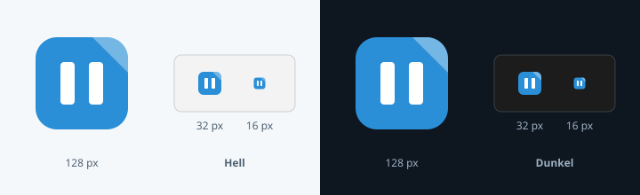
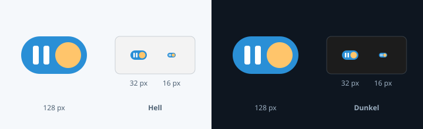
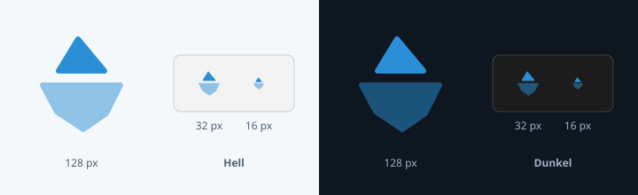
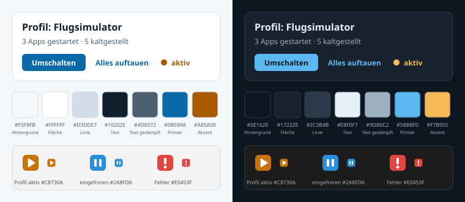

# Branding: Logo- und Farbvorschläge

Status: **Vorschläge zur Auswahl**, nichts davon ist entschieden.

Fünf Logo-Richtungen und drei Farbschemata für `kaltstellen`. Alle Marken sind
eigene, von Hand geschriebene SVG-Skizzen auf einem 32er-Raster, ohne fremde
Icon-Sets, Schriften oder Markenzeichen. Sie stehen unter derselben Lizenz wie
der Rest des Repos.

Zum schnellen Vergleichen: [uebersicht.html](uebersicht.html) im Browser öffnen.
Dort sind die kleinen Größen in echten 32 und 16 Pixeln gezeichnet. Die Bilder
unten zeigen dasselbe, werden aber je nach Fensterbreite skaliert.

## Logo-Richtungen

Jede Vorschau zeigt die Marke groß und als Tray-Symbol in 32 und 16 px, links
auf hellem, rechts auf dunklem Grund. Die Marken verwenden ein mittleres Blau
(`#2A8FD6`), das auf heller wie dunkler Taskleiste über 3 : 1 Kontrast hält,
sodass eine einzige Datei für beide Windows-Designs reicht.

### 01 · Eiswürfel

Ein Eiswürfel mit Pause-Zeichen: »auf Eis legen« und »anhalten« in einem Bild.
Die geschlossene Fläche bleibt auch bei 16 px ein klarer Fleck, die beiden
Balken sind dort je 2 px breit.

### 02 · Kristall-K

Das K von kaltstellen als Eiskristall: Stamm und zwei kräftige Arme, die andere
Kristallhälfte ist nur blass angedeutet. Als Buchstabenmarke eigenständig und
gut für Avatar und Wortmarke; bei 16 px liest man je nach Blick ein K oder eine
Schneeflocke, beides passt.

### 03 · Schalter

Ein Kippschalter: links die eingefrorene Seite mit Pause-Zeichen, rechts der
warme Knopf für das aktive Profil. Erzählt das Umschalten am direktesten, ist
aber breit statt quadratisch und nutzt die Tray-Fläche nur zur Hälfte.

### 04 · Profilring

Ein Drehschalter: drei Ringsegmente stehen für drei Profile, der Zeiger steht
auf dem aktiven, warmen Segment. Das aktive Segment könnte im Tray mitwandern;
das Motiv sagt aber nichts über Kälte oder Einfrieren und erinnert entfernt an
ein Power-Symbol.

### 05 · Eisberg

Nur die Spitze ist oben und arbeitet, der große Rest liegt still unter der
Wasserlinie. Das ruhigste und bildhafteste Motiv, es erklärt aber weder Pause
noch Umschalten und lebt von der zweiten Tonstufe.

## Farbschemata

Jedes Blatt zeigt links die helle, rechts die dunkle Variante: eine
Beispielkarte, die sieben Rollenfarben und unten die drei Tray-Zustände auf
heller (`#F3F3F3`) und dunkler (`#1C1C1C`) Taskleiste.

Die Zustände unterscheiden sich immer in Farbe **und** Zeichen (Play, Pause,
Ausrufezeichen), damit sie auch bei Farbfehlsichtigkeit lesbar bleiben. Die
Zustandssymbole sind hier mit dem Eiswürfel gezeichnet; für eine andere Marke
müsste das Zeichen als kleines Abzeichen an die Marke wandern.

Kontrastwerte nach WCAG 2.x, jeweils gegen den Hintergrund des Modus. Richtwerte:
4,5 : 1 für Text, 3 : 1 für Grafiken und Bedienelemente.

### A · Gletscher

Eisblau mit warmem Bernstein als Gegenpol: kalt = geparkt, warm = läuft.

| Rolle | Hell | Dunkel |
| --- | --- | --- |
| Hintergrund | `#F5F8FB` | `#0E1620` |
| Fläche | `#FFFFFF` | `#17222E` |
| Linie | `#D3DDE7` | `#2C3B4B` |
| Text | `#10202E` (15,5) | `#E8F0F7` (15,8) |
| Text gedämpft | `#4D6072` (6,1) | `#9DB0C2` (8,2) |
| Primär | `#0B69A8` (5,5) | `#5BB8F0` (8,3) |
| Akzent | `#A85A00` (4,8) | `#F7B955` (10,4) |
| Schrift auf Primär | `#FFFFFF` (5,8) | `#0E1620` (8,3) |

| Tray-Zustand | Farbe | helle Taskleiste | dunkle Taskleiste |
| --- | --- | --- | --- |
| Profil aktiv | `#C8730A` | 3,2 | 4,8 |
| eingefroren | `#2A8FD6` | 3,2 | 4,9 |
| Fehler | `#E0453F` | 3,7 | 4,1 |

Schwachpunkt: Bernstein für »aktiv« und Rot für »Fehler« liegen im Farbkreis
nah beieinander und Bernstein wird sonst oft als Warnung gelesen. Das Zeichen
im Symbol muss die Unterscheidung mittragen.

### B · Polarlicht

Indigo der Polarnacht mit Mintgrün des Polarlichts: technischer, weniger
»Wetter-App«.

| Rolle | Hell | Dunkel |
| --- | --- | --- |
| Hintergrund | `#F7F7FC` | `#111122` |
| Fläche | `#FFFFFF` | `#1B1B33` |
| Linie | `#DCDCEC` | `#30304F` |
| Text | `#16162B` (16,6) | `#ECECFA` (15,9) |
| Text gedämpft | `#55556F` (6,7) | `#A6A6C4` (7,9) |
| Primär | `#4450D6` (5,8) | `#8E98FF` (7,2) |
| Akzent | `#0B7F6B` (4,6) | `#45D6B0` (10,2) |
| Schrift auf Primär | `#FFFFFF` (6,2) | `#111122` (7,2) |

| Tray-Zustand | Farbe | helle Taskleiste | dunkle Taskleiste |
| --- | --- | --- | --- |
| Profil aktiv | `#0F9485` | 3,4 | 4,5 |
| eingefroren | `#6F7DF5` | 3,2 | 4,8 |
| Fehler | `#E0453F` | 3,7 | 4,1 |

Stärke: Grün für »aktiv«, Rot für »Fehler« ist die gewohnte Ampel-Lesart.
Schwachpunkt: Grün und Rot sind genau das Paar, das bei Rot-Grün-Schwäche
verschwimmt; und Indigo wirkt weniger nach Eis als Blau oder Petrol.

### C · Wintersonne

Petrol wie Gletscherwasser mit Sonnengelb: freundlich und am weitesten weg vom
üblichen Windows-Blau.

| Rolle | Hell | Dunkel |
| --- | --- | --- |
| Hintergrund | `#F4F8F8` | `#0B191C` |
| Fläche | `#FFFFFF` | `#13262B` |
| Linie | `#CFDEDF` | `#274046` |
| Text | `#0F2327` (15,2) | `#E6F2F3` (15,7) |
| Text gedämpft | `#48626A` (6,1) | `#9AB5BA` (8,3) |
| Primär | `#0A7582` (5,1) | `#4CC9D6` (9,1) |
| Akzent | `#8A6500` (5,0) | `#F2C230` (10,7) |
| Schrift auf Primär | `#FFFFFF` (5,4) | `#0B191C` (9,1) |

| Tray-Zustand | Farbe | helle Taskleiste | dunkle Taskleiste |
| --- | --- | --- | --- |
| Profil aktiv | `#B07F00` | 3,2 | 4,8 |
| eingefroren | `#0E9AA7` | 3,1 | 5,0 |
| Fehler | `#E0453F` | 3,7 | 4,1 |

Schwachpunkt: Gelb muss für helle Hintergründe stark abgedunkelt werden und
kippt dabei ins Ocker; das leuchtende Sonnengelb gibt es nur im dunklen Modus.

## Empfehlung

**Kristall-K mit Schema A · Gletscher.**

- Das K ist die einzige der fünf Marken, die niemand mit einem Mediaplayer, einem
  Einstellungsschalter oder einem Ladekreis verwechselt, und sie bleibt bei
  16 px als kräftiges Zeichen stehen.
- Gletscher passt am direktesten zum Namen. Der Bernstein-Akzent liefert den
  Gegensatz kalt/warm, den das Werkzeug herstellt, und das Tray-Blau der Marke
  ist bereits die »eingefroren«-Farbe des Schemas.

**Zweite Wahl: Eiswürfel.** Er ist im Tray am robustesten und trägt die
Zustände schon in sich (Pause, Play, Ausrufezeichen wie in den Farbblättern),
wirkt dafür aber austauschbarer. Wer die Tray-Funktion über die
Wiedererkennbarkeit stellt, nimmt ihn. Logo und Schema sind unabhängig
voneinander wählbar; jede Marke lässt sich in jedes Schema umfärben.

## Was nach der Auswahl noch fehlt

- Die 16-px-Fassung von Hand auf das Pixelraster setzen und als `.ico` mit
  16, 20, 24, 32, 48 und 256 px ausgeben. Die Skizzen hier sind dafür nicht
  nachgeschärft.
- Zustandssymbole für die gewählte Marke zeichnen (bisher nur für den Eiswürfel).
- Wortmarke und Social-Preview-Bild für GitHub.

## Dateien

| Pfad | Inhalt |
| --- | --- |
| `logos/NN-name.svg` | Marke, transparenter Grund, 32er-Raster |
| `logos/NN-name-avatar.svg` | Marke auf dunkler Kachel, für Avatar und README |
| `vorschau/NN-name.svg` | Vergleichsblatt: groß, 32 px, 16 px, hell und dunkel |
| `farben/schema-*.svg` | Farbblatt je Schema mit Tray-Zuständen |
| `uebersicht.html` | alles auf einer Seite, ohne externe Abhängigkeiten |
