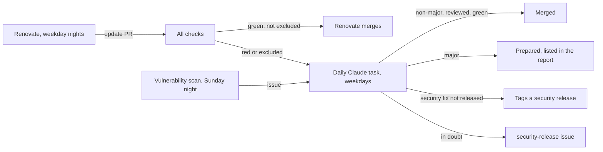

# Automated maintenance

Dependencies and security fixes are looked after without anyone watching.
This page says what runs, what is merged on its own and what always waits
for a person.

## Renovate

Configuration: [`renovate.json`](../renovate.json).

- Updates are raised on weekday nights (00:00 to 06:00, Europe/Berlin), at
  most 5 PRs open at once. A release must be 3 days old first. Security fixes
  are raised at once and skip that wait.
- The `windows` crates and the GitHub Actions are grouped. Lock file
  maintenance runs on Monday night and has no waiting time.
- Security PRs carry the label `security`.
- Renovate merges a PR itself when **every** check on it is green, the ARM64
  job included. GitHub's own auto-merge stays off: it would only wait for the
  required check `check`.
- **Merged on their own:** patch and minor updates, pins and digests, lock
  file maintenance, and security fixes of packages that are not listed below.
- **Never merged on their own** (label `needs-review`):
  - every major update (label `major`);
  - minor updates of `0.x` crates (a minor step may break the API);
  - core libraries: `windows`, `windows-*`, `webview2-com`, `serde`,
    `serde_json`, `toml`, `toml_edit`;
  - the Rust toolchain in `rust-toolchain.toml`;
  - the release-chain actions `actions/attest-build-provenance`,
    `actions/upload-artifact`, `actions/download-artifact`.

## Vulnerability scan

[`vulnerability-scan.yml`](../.github/workflows/vulnerability-scan.yml) runs
`cargo audit` on `Cargo.lock` every Sunday night. One open issue labelled
`vulnerability` lists the findings; a clean run closes it. It is not a
required check. `security.yml` (cargo-deny) still runs on every change and
daily.

## Daily Claude task

Every weekday at about 06:00 (Europe/Berlin) a scheduled Claude task in the
cloud (`Softwarepflege kaltstellen`) runs in two stages, so that a day
without work costs almost nothing:

1. **Triage with a small, inexpensive model.** It looks at open PRs by
   `renovate[bot]`, at red checks (on `main` and on those PRs), at open
   issues labelled `vulnerability` or `security-release`, and at security
   fixes that are merged but not released. If there is nothing, it ends at
   once and makes no further calls.
2. **Work with a stronger model.** Otherwise the triage model starts a
   stronger model (Sonnet) as a subagent. That subagent repairs red checks
   and prepares the updates, but does not merge.
3. **Independent review before every merge.** A separate reviewer subagent
   (Opus) reads the dependency's changelog and the diff. The task merges a
   non-major update only after a review without objection and with every
   check green on the current head, the ARM64 job included.
4. **Majors are prepared, never merged.** They are listed in the report.
5. **Security release decision**, see below.

It touches no other PRs, never force-pushes and changes no settings. CI can
be started by hand with the `workflow_dispatch` trigger of `ci.yml`.

## Security releases

When pull requests labelled `security` were merged after the latest release,
the daily task decides whether to publish them:

- It releases only when the fixed dependency is part of the shipped
  executable or setup (not a build, test or CI tool), and when everything on
  `main` since the latest release is dependency updates, maintenance and bug
  fixes.
- It then creates the next version tag on the tip of `main`, with `main`
  green: the patch number is raised (`v1.2.3` becomes `v1.2.4`); during a
  pre-release series the pre-release number is raised (`v1.0.0-beta.6`
  becomes `v1.0.0-beta.7`). The tag starts
  [`release.yml`](../.github/workflows/release.yml), which builds, attests
  and publishes as for any other release ([releasing.md](releasing.md)).
- It checks afterwards that the release is published with all its files.
- In any other case, or when in doubt, it publishes nothing and opens an
  issue `Security release needs a decision` (label `security-release`).

At most one security release per run. Every other release stays a decision
of the maintainer.

## One-time setup

`scripts/setup-maintenance.sh` checks the repository settings these jobs
depend on and, with `--apply`, fixes what it can through the GitHub API.

## Deviations from the standard

- The security release is started by a tag that the daily task creates,
  not by a `workflow_dispatch` run: in this repository the tag sets the
  version, and `release.yml` stays as it is. That tag is not signed.
