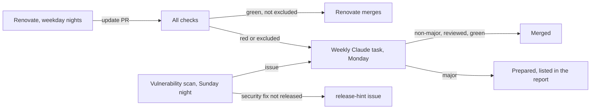

# Automated maintenance

Dependencies and security fixes are looked after without anyone watching.
This page says what runs, what is merged on its own and what always waits
for a person.

## Renovate

Configuration: [`.github/renovate.json5`](../.github/renovate.json5).

- Updates are raised on weekday nights (Europe/Berlin), at most 5 PRs open
  at once. A release must be 3 days old first. Security fixes are raised at
  once and skip that wait.
- The `windows` crates and the GitHub Actions are grouped.
- Renovate merges a PR itself when **every** check on it is green, the ARM64
  job included. GitHub's own auto-merge stays off: it would only wait for the
  required check `check`.
- **Merged on their own:** patch and minor updates, action digests, lock file
  maintenance, and security fixes of packages that are not listed below.
- **Never merged on their own** (label `needs-review`):
  - every major update;
  - minor updates of `0.x` crates (a minor step may break the API);
  - core libraries: `windows`, `windows-*`, `webview2-com`, `serde`,
    `serde_json`, `toml`, `toml_edit`;
  - the Rust toolchain in `rust-toolchain.toml`;
  - the release-chain actions `actions/attest-build-provenance`,
    `actions/upload-artifact`, `actions/download-artifact`.

## Vulnerability scan

[`vulnerability-scan.yml`](../.github/workflows/vulnerability-scan.yml) runs
`cargo audit` on `Cargo.lock` every Sunday night. One open issue labelled
`vulnerability` lists the findings; a clean run closes it. It is not a
required check. `security.yml` (cargo-deny) still runs on every change and
daily.

The same run opens an issue labelled `release-hint` when security fixes
(merged PRs labelled `security`) are newer than the latest release. It never
tags or releases anything.

## Weekly Claude task

Every Monday morning a scheduled Claude task in the cloud:

1. Looks at open PRs by `renovate[bot]` and at open issues labelled
   `vulnerability`. If there is nothing, it ends at once.
2. Repairs red checks on those PRs.
3. Merges non-major updates after an independent review and green CI.
4. Prepares major updates, but does not merge them, and lists them in its
   report.

It touches no other PRs, creates no tags and no releases, and never
force-pushes. CI can be started by hand with the `workflow_dispatch` trigger
of `ci.yml`.

## Releases

A release is always a decision of the maintainer. Nothing here tags or
publishes (see [releasing.md](releasing.md)).

## One-time setup

`scripts/setup-maintenance.sh` checks the repository settings these jobs
depend on and, with `--apply`, fixes what it can through the GitHub API.
